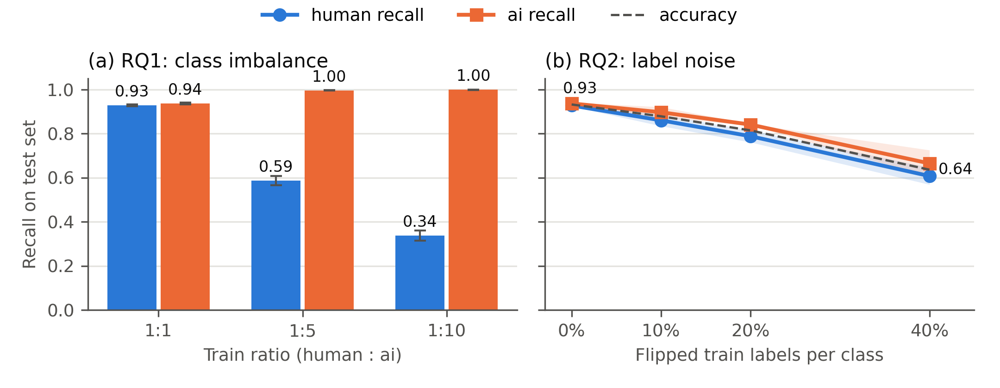
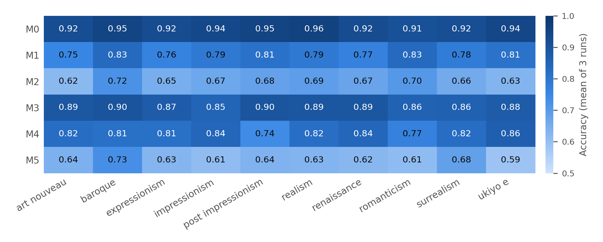

# Human vs. AI Artwork Classification: Effects of Class Imbalance and Label Noise

EF2039 AI Programming, Programming Assignment 04.

This repository studies how two data problems affect a binary image classifier
that separates **human-made artworks** from **AI-generated artworks**:

- **RQ1 (class imbalance):** How does the test performance change when the human class becomes a minority in the training set (1:1, 1:5, 1:10)?
- **RQ2 (label noise):** How does the test performance change when 10%, 20% or 40% of the training labels are flipped?

All models are trained with Google Teachable Machine under identical settings.
Each condition is trained 3 times, and every model is evaluated on the same fixed test set of 1,000 images.

## Main results

Mean ± standard deviation over 3 training runs, test set of 500 human + 500 AI images.

| Model | Training condition | Accuracy | Recall (human) | Recall (ai) | Macro F1 |
|---|---|---|---|---|---|
| M0 | baseline, 200 human / 200 ai, clean labels | 0.933 ± 0.004 | 0.928 ± 0.004 | 0.937 ± 0.005 | 0.933 ± 0.004 |
| M1 | imbalance 1:5 (40 human / 200 ai) | 0.792 ± 0.011 | 0.588 ± 0.021 | 0.997 ± 0.001 | 0.783 ± 0.012 |
| M2 | imbalance 1:10 (20 human / 200 ai) | 0.669 ± 0.012 | 0.338 ± 0.023 | 0.999 ± 0.001 | 0.628 ± 0.017 |
| M3 | label noise 10% | 0.879 ± 0.003 | 0.861 ± 0.026 | 0.897 ± 0.024 | 0.879 ± 0.003 |
| M4 | label noise 20% | 0.815 ± 0.012 | 0.789 ± 0.027 | 0.841 ± 0.003 | 0.815 ± 0.012 |
| M5 | label noise 40% | 0.637 ± 0.037 | 0.608 ± 0.039 | 0.665 ± 0.060 | 0.636 ± 0.037 |





## Repository structure

```
ai-art-detection/
├── README.md
├── environment.yml            # Conda environment (Python 3.10, TensorFlow 2.15)
├── scripts/
│   ├── make_splits.py         # builds data/ from the original Kaggle zip
│   ├── evaluate.py            # evaluates all models, writes results/*.csv
│   └── make_figures.py        # draws results/*.png from the CSV files
├── data/
│   ├── train/M0 ... M5/{human,ai}/   # training images uploaded to Teachable Machine
│   ├── test/{human,ai}/              # fixed test set (never used for training)
│   ├── manifest_train.csv            # every training image: experiment, train label, true label, flipped, style, original path
│   └── manifest_test.csv             # every test image: true label, style, original path
├── model/
│   └── M0 ... M5/run1 ... run3/{keras_model.h5, labels.txt}   # 18 trained models
└── results/
    ├── predictions.csv        # 18,000 predictions (model, run, file, style, true, predicted, scores)
    ├── metrics_per_run.csv    # metrics of each of the 18 models
    ├── metrics_summary.csv    # mean and std over the 3 runs of each model
    ├── fig1_research_questions.png
    └── fig2_style_accuracy.png
```

## Data

**Source.** [AI-ArtBench](https://www.kaggle.com/datasets/ravidussilva/real-ai-art) (Kaggle, `ravidussilva/real-ai-art`).
It contains human-made artworks from ArtBench-10 and AI-generated artworks in the same 10 art styles.
AI-ArtBench is released under the MIT License; the human artworks come from ArtBench-10, please check its own terms before reuse.

**Classes used.**

| Class | Source folder in the original zip | Image size |
|---|---|---|
| `human` | `Real_AI_SD_LD_Dataset/{train,test}/<style>` | 256 × 256 RGB |
| `ai` | `Real_AI_SD_LD_Dataset/{train,test}/AI_LD_<style>` (Latent Diffusion) | 256 × 256 RGB |

Stable Diffusion images (`AI_SD_*`, 768 × 768) were excluded so that both classes have the same resolution
and the model cannot separate them by image size alone.

**Styles (10).** art nouveau, baroque, expressionism, impressionism, post-impressionism, realism, renaissance, romanticism, surrealism, ukiyo-e.

**Sampling.** `scripts/make_splits.py` samples images at random with a fixed seed (2039):

- Train: 20 images per style and class from the **official train split** → 200 human + 200 ai.
- Test: 50 images per style and class from the **official test split** → 500 human + 500 ai.

Train and test images come from different official splits, so they do not overlap.

**Training sets per experiment.** Only the studied factor changes; the subsets are nested
(M2's human images ⊂ M1's ⊂ M0's; the labels flipped in M3 are also flipped in M4 and M5).

| Model | `human` folder | `ai` folder | Flipped labels |
|---|---|---|---|
| M0 | 200 | 200 | 0 |
| M1 | 40 (4 per style) | 200 | 0 |
| M2 | 20 (2 per style) | 200 | 0 |
| M3 | 200 (180 true human + 20 ai) | 200 (180 true ai + 20 human) | 40 (10% per class) |
| M4 | 200 (160 + 40) | 200 (160 + 40) | 80 (20% per class) |
| M5 | 200 (120 + 80) | 200 (120 + 80) | 160 (40% per class) |

File names keep the true class and style (e.g. `ai_baroque_008.jpg` inside `train/M5/human/` is a flipped AI image).

## Model and training

- **Tool:** [Teachable Machine](https://teachablemachine.withgoogle.com/) → Image Project → Standard image model.
  It uses transfer learning on a pretrained MobileNet: the backbone is frozen and only the classification head is trained.
- **Classes:** class 1 `human`, class 2 `ai` (so `labels.txt` is `0 human`, `1 ai`).
- **Settings (default, identical for all models):** 50 epochs, batch size 16, learning rate 0.001.
  Teachable Machine holds out 15% of the uploaded images internally for validation.
- **Repetitions:** each training set was trained 3 times (run1–run3). The runs differ only by Teachable Machine's internal randomness.
- **Export:** Tensorflow → Keras → `keras_model.h5` + `labels.txt`.

## Evaluation protocol

`scripts/evaluate.py` extends the course example `03_evaluate_ai_model.py`:

- Preprocessing matches Teachable Machine: read image, convert **BGR → RGB**, resize to 224 × 224, scale to [-1, 1].
- The predicted class is the class with the highest score.
- Metrics: accuracy, per-class precision / recall / F1, macro F1 and the confusion matrix, computed for each of the 18 models
  and summarized as mean ± sample standard deviation over the 3 runs.

## Reproduce the results

Tested on Windows (CPU) and Linux (CPU), with identical results. No GPU is needed.

**1. Clone the repository**

```bash
git clone https://github.com/dongy2on/ai-art-detection.git
cd ai-art-detection
```

**2. Create the environment**

```bash
conda env create -f environment.yml
conda activate ai_art
```

**3. Evaluate the 18 trained models**

```bash
python scripts/evaluate.py
```

The summary table printed at the end should match the table in *Main results*.
Use `--models M0 M2` to evaluate only some models, or `--save-images` to also save correctly and wrongly classified images.

**4. Draw the figures**

```bash
python scripts/make_figures.py
```

**5. (Optional) Rebuild the data from the original dataset**

The `data/` folder is already included. To rebuild it, download the Kaggle zip (about 11 GB) and run:

```bash
python scripts/make_splits.py --zip <path to real-ai-art.zip> --out data_rebuilt
```

With the same seed, `data_rebuilt/` contains exactly the same images as `data/`.

**6. (Optional) Retrain a model**

Upload `data/train/<model>/human` as class `human` and `data/train/<model>/ai` as class `ai` to Teachable Machine,
keep the default settings, train, and export as Keras. Results will differ slightly from the provided models because of training randomness.
